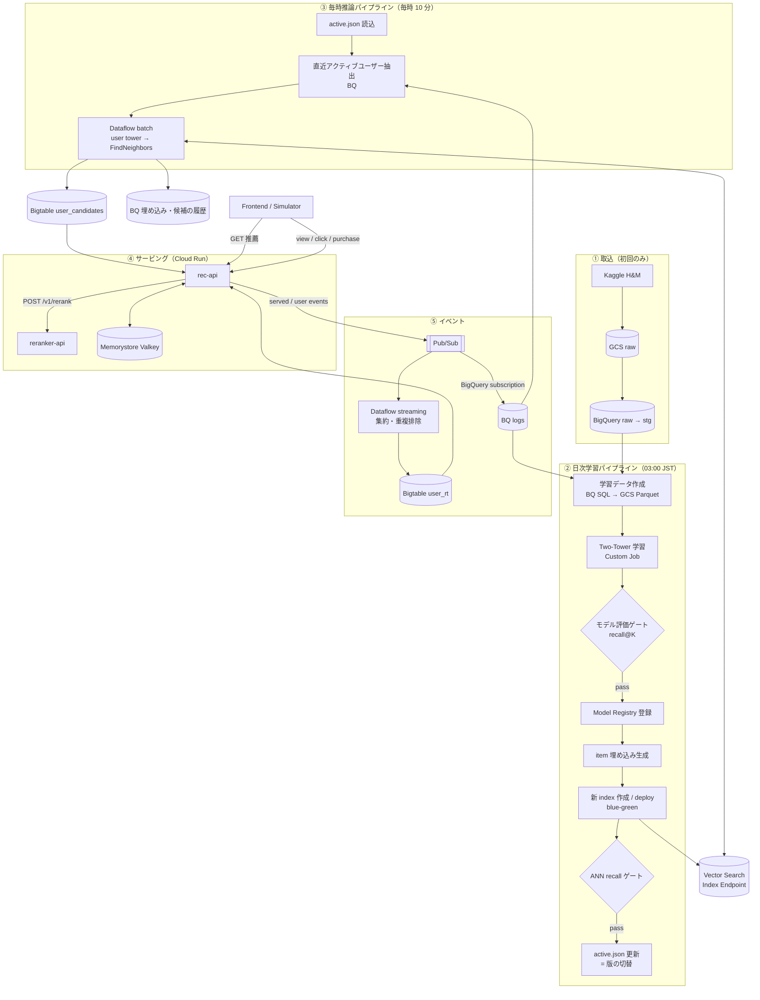
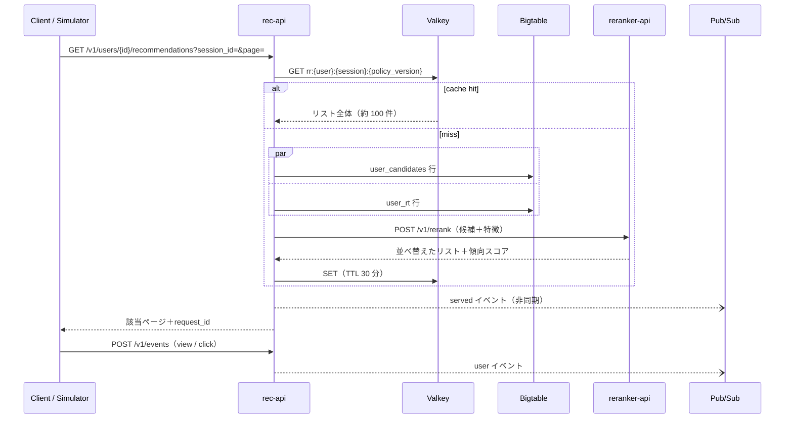

# アーキテクチャ設計書 v0.1

[00_research_notes.md](./00_research_notes.md) の調査を元にした設計です。`[Z1]` などの記号はそこでの出典 ID です。

---

## 0. ゴール / 非ゴール

**ゴール（練習したいこと）**
1. Two-Tower の日次学習パイプライン（Vertex AI Pipelines）
2. 毎時の推論から Vector Search の近傍探索を経て、結果を Bigtable に保存するまでのパイプライン
3. Bigtable の候補をフロントに返す推薦 API
4. リクエストごとにリアルタイムで計算する Reranker API。行動ログがほとんど変わらないユーザーにも、毎回少しずつ違う結果を返す

**前提**: 大規模プロダクトを想定する
- データは GCS → BigQuery を経由させる
- Dataflow / Pub/Sub / キャッシュを使う
- モデルのバージョン管理・評価ゲート・監視・IaC を備える

**非ゴール（今回はやらない）**
- オンラインの user tower 推論（リクエスト時の ANN）。[F2][P1] のような構成で、発展課題とする
- マルチリージョン構成、SLA を保証する冗長化（コストの都合で最小レプリカで動かす）

---

## 1. 全体像



| 処理 | 周期 | 実行基盤 | 主な出力 |
|---|---|---|---|
| 取込 | 初回のみ | ローカル / Cloud Run Job | GCS raw、BQ raw |
| 学習 | 日次 | Vertex AI Pipelines＋Custom Training | Model Registry、item 埋め込み、新しい index、`active.json` |
| 推論・近傍探索 | 毎時 | Vertex AI Pipelines＋Dataflow batch | Bigtable `user_candidates`、BQ の履歴 |
| 推薦 API | リクエスト時 | Cloud Run `rec-api` | レスポンス、served イベント |
| Reranker | リクエスト時 | Cloud Run `reranker-api` | 並べ替えたリスト＋傾向スコア |
| リアルタイム特徴 | 常時（練習日のみ） | Dataflow streaming | Bigtable `user_rt` |
| 生ログ | 常時 | Pub/Sub BigQuery subscription | BQ `logs.*` |

---

## 2. 時間の扱い（論理時刻とリプレイ）

H&M は過去のデータで、時刻も日付単位しかありません。そこで本番の運用に近づけるため、次のようにします。

- **論理時刻 `logical_ts`**: すべてのパイプラインは「どの時点のデータで処理するか」を引数で受け取ります（Airflow の logical date と同じ考え方）。スケジュール実行では予定時刻が渡されます。こうしておくと、同じ時刻で何度実行しても結果が変わらず、過去分の再実行もできます。
- **時刻シフト**: データセットの時刻を `stg.sim_config.time_offset_days` 日だけ現在へずらします。
  - offset は「リプレイ期間の初日 = 指定した壁時計の日付」になるよう自動で計算します。
  - `stg` は view ではなく**テーブル**で作ります。こうすると `event_date` でパーティションを絞り込めて、日次の学習データ作成で読む量が減ります。
  - 練習を再開するときは `make stg REPLAY_START=YYYY-MM-DD` で作り直せば、基準日を付け替えられます（数 GB のスキャンで、ほぼ無料枠内）。
- **日内時刻の合成**（`recsys/sim/time_profile.py` と `sql/stg/transactions.sql`）:
  - 同じ顧客の同じ日の購入は 1 セッションとみなし、セッションの開始時刻を `hash(customer_id, date)` から決めます。時間帯の分布は、昼と 20〜22 時がピークになる EC の典型的な形に合わせます。
  - 各アイテムはセッション開始から 0〜20 分の範囲に散らします。
  - ハッシュで決めるので、何度作り直しても同じ時刻になります。これで「毎時アクティブなユーザー」が自然に入れ替わります。
- **期間の分け方**（具体的な日付はデータ取得後に決める）:
  - 履歴期間: 最後の約 4 週間を除いた全期間。初回に BQ へ一括で入れる
  - リプレイ期間: 最後の約 4 週間。シミュレータが Pub/Sub にリアルタイムで流す

---

## 3. データレイヤ（GCS / BigQuery）

### GCS
| バケット | 用途 | ライフサイクル |
|---|---|---|
| `{prj}-raw` | Kaggle の原本（変更しない） | 永続 |
| `{prj}-ml` | 学習データ Parquet、モデル成果物、item 埋め込み、index の入力、`manifest/` | 版ごとに 30 日 |
| `{prj}-staging` | Dataflow / Pipelines の一時ファイル | 7 日 |

### BigQuery
| データセット | 主なテーブル | 備考 |
|---|---|---|
| `raw` | `transactions`, `customers`, `articles` | CSV をそのままロード |
| `stg` | `transactions`（`event_date` でパーティション）, `customers`, `articles`, `sim_config` | 型変換・時刻合成・時刻シフト |
| `feature` | `user_features_daily`, `item_features_daily` | `snapshot_date` でパーティション。point-in-time を保証 |
| `ml` | `training_examples`, `item_embeddings`, `user_embeddings`, `candidates_history`, `model_manifest` | 版・時刻でパーティション |
| `logs` | `user_events`, `served_events` | Pub/Sub の BigQuery サブスクリプションで取り込む。イベント時刻でパーティション |

学習とリプレイが一巡すると、データは `raw/stg → feature → ml → (Bigtable) → logs → feature` と循環します。

---

## 4. 日次学習パイプライン

**モデル**: PyTorch で自作します。

| 部分 | 設計 |
|---|---|
| User tower | customer_id（hash 埋め込み）、年齢バケット、会員ステータス、ニュース購読頻度、**直近 N 件の購入アイテムの平均プーリング**（item ID の埋め込みは item tower と共有）、直近のカテゴリ分布、最終購入からの日数 |
| Item tower | article_id（hash）、product_type / group、colour、department、index、section、garment_group、価格（log1p）、直近 7 日の人気度、発売からの日数 |
| 学習 | in-batch softmax＋logQ 補正＋L2 正規化＋temperature [Y2][U1]。同一アイテムが別行の負例になるもの（偽負例）はマスクする [T1]。次元は 64 から始める |
| データ | 直近 N 週の購入が正例（初期値 12 週、実験で決める）。ユーザーごとのサンプル数に上限 [Y1] |

hashing などの前処理は共通パッケージ `recsys.features` に置き、学習と Dataflow の両方から使います [G2]。

**パイプラインのステップ**

| # | コンポーネント | 処理 | 失敗時 |
|---|---|---|---|
| 1 | `validate_inputs` | 件数・鮮度・NULL 率をチェック | 停止 |
| 2 | `build_dataset` | BQ SQL で `training_examples` を作り、`EXPORT DATA` で GCS に Parquet 出力 | 停止 |
| 3 | `train` | Custom Job（CPU で開始し、必要なら T4） | 停止 |
| 4 | `evaluate` | 翌日〜7日の holdout で recall@{100,300}（厳密計算）を、人気ベースライン・現行モデルと比較 | ゲート不合格なら終了（現行版を維持） |
| 5 | `register` | user / item の両タワーを同じ `model_version` で Registry に登録（エイリアスは `candidate`） | 停止 |
| 6 | `embed_items` | 全 item を item tower にかけ、GCS（Vector Search 用 JSON）と BQ `ml.item_embeddings` に出力 | 停止 |
| 7 | `build_and_deploy_index` | 新しい index（BATCH_UPDATE）を作り、同じエンドポイントに `deployed_index_id=tt_v{model_version}` で deploy（20〜30 分） | 停止。旧版はそのまま |
| 8 | `ann_recall_check` | 1,000 ユーザーをサンプルし、ANN の結果を厳密な kNN と比べて recall@300 ≥ 0.95 を確認 [G1][F1] | 停止して新しい index を undeploy |
| 9 | `promote` | `active.json` を原子的に書き換え、BQ の `model_manifest` に記録し、Registry のエイリアスを `production` に付け替える | — |
| 10 | `cleanup` | 2 世代前の deployed index を undeploy | 警告のみ |

**ゲートの初期値**（運用しながら調整します）
- `recall@300(new) ≥ 0.98 × recall@300(current)`
- `recall@300(new) > recall@300(popularity)`

---

## 5. 毎時推論パイプライン

| # | ステップ | 処理 |
|---|---|---|
| 1 | `resolve_active` | `active.json` を読み、`model_version` / `user_tower_uri` / `deployed_index_id` を取り出す |
| 2 | `select_users` | `logs.user_events` から、直近 1 時間にイベントがあったユーザーを抽出する [Z2]。**版を切り替えた直後の 1 回**は、直近 7 日のアクティブユーザー全員を対象にする |
| 3 | `retrieve`（Dataflow） | ユーザー特徴を BQ から読む → RunInference（user tower）→ 100 件ずつまとめて FindNeighbors（neighbor_count=300）→ 3 か所に出力（下の箇条書き） |
| 4 | `popular_fallback` | セグメント別（年齢バケットなど）の人気順リストを作り、GCS と Bigtable に置く |
| 5 | `quality_check` | ゼロベクトル率、候補数の分布、生成件数とユーザー数の一致を確認する [Z6] |

`retrieve` の出力先:
- Bigtable `user_candidates`
- BQ `ml.user_embeddings`
- BQ `ml.candidates_history`

**レート制御**: FindNeighbors は DoFn の中でまとめて送り、指数バックオフでリトライします。ワーカー数の上限で同時に送るリクエスト数も抑えます。

---

## 6. モデルのバージョン管理（blue/green）

```
gs://{prj}-ml/manifest/active.json   ← 唯一の「現在有効な版」
{
  "model_version": "20261108-0300",
  "user_tower_uri": "gs://.../models/20261108-0300/user_tower/",
  "item_embeddings_uri": "gs://.../embeddings/20261108-0300/items.parquet",
  "index_endpoint": "projects/.../indexEndpoints/...",
  "deployed_index_id": "tt_v20261108_0300",
  "activated_at": "2026-11-08T03:52:10+09:00"
}
```

- **active.json を書き換えるのは `promote` だけ**です。GCS のオブジェクトは1回の書き込みで丸ごと置き換わるので、読み手が中途半端な状態を見ることはありません。
- 記録は BQ の `model_manifest`（STAGING / ACTIVE / ARCHIVE）[Z2] と Registry のエイリアスにも残しますが、**処理が参照するのは active.json だけ**です。
- 毎時ジョブは active.json の `user_tower_uri` と `deployed_index_id` をペアで使います。そのため、user ベクトルと index の版がずれることはありません [Z1][P1]。
- 切り替えの直後は、Bigtable に旧版で作った候補が残っています。**候補はアイテム ID の並びなので、旧版のものでも推薦として有効**です。次にそのユーザーがアクティブになったとき（または切替直後の全体更新で）新しい版に置き換わります。
- Reranker が多様化に使う item 埋め込みは、active な版の空間で計算します。同じリストの中では1つの空間で類似度を測るので、問題ありません。
- **ロールバック**: `active.json` を前の版に戻せば終わります。前の版の index は 1 世代残しておきます。

---

## 7. Bigtable スキーマ

インスタンスは 1 つ（1 ノード SSD）で、テーブルを 2 つ作ります。customer_id は H&M の時点で既にハッシュ文字列なので、そのまま行キーの先頭に置いても書き込みが一部のノードに偏りません。

### `user_candidates`
| 項目 | 内容 |
|---|---|
| 行キー | `u#{customer_id}`。人気リストは `pop#{segment}` |
| CF `c` | qualifier は `list`。値は msgpack で `{model_version, generated_at, items:[...], scores:[...]}`（約 300 件、約 5KB） |
| GC | `maxversions=2 OR maxage=7d` |
| 読み取り | 最新セルだけを読む。**GC は遅れて走るので、`generated_at` が 7 日より前なら読んだ側で無視する** |

### `user_rt`（リアルタイム特徴）
| CF | qualifier | 値 | GC |
|---|---|---|---|
| `imp`（aggregate sum） | `{yyyymmdd}#{article_id}` | 表示回数 | maxage=8d |
| `clk`（aggregate sum） | `{yyyymmdd}#{article_id}` | クリック回数 | maxage=31d |
| `last` | `seen#{article_id}` / `click#{article_id}` | 最後に表示・クリックした時刻（セルのタイムスタンプ） | maxage=8d |
| `pur` | `{article_id}` | 購入した時刻 | maxage=31d |

- 日付ごとにカウンタを分けたのは、読み出すときに時間減衰（古い日ほど小さく数える）を計算できるようにするためです。
- 書き込むのは Dataflow streaming です（§10）。

---

## 8. サービング API

### 8.1 構成（[C1][C2] の Gateway / Reranker 分離を踏襲）



### 8.2 rec-api（FastAPI、Cloud Run）
- Bigtable は非同期クライアントで 2 行を並列に読みます。タイムアウトは 30ms、リトライは 1 回です [Z8]。
- **フォールバックは段階的に**します。
  - 候補がない → 人気順リスト（GCS から読み、メモリに保持。10 分ごとに更新）[C2]
  - reranker がタイムアウト（60ms）またはエラー → 候補を元の順で返し、購入済みだけ除く
- **キャッシュ**: キーは `rr:{user}:{session}:{policy_version}` です。リランク後のリスト全体をセッション単位で 30 分保持し、ページ送りしても並びが変わらないようにします。
  - キーは必ずユーザーとセッション単位にします。ユーザー間で共有されるキーにすると、パーソナライズが崩れます [C1]。
  - ヒット率を計測し、効かないなら Valkey ごと外します [C2]。
- アイテムのメタデータ（名前・画像 URL など）はプロセス内の LRU に載せ、起動時に GCS から読み込みます。
- イベントは Pub/Sub クライアントの batching を使って非同期で送り、レスポンスを待たせません。

### 8.3 reranker-api（FastAPI、Cloud Run）
- 計算だけを担い、状態を持ちません。`POST /v1/rerank` を受けて `{items:[{item_id, position, propensity, explore}], policy_version}` を返します。
- プロセス内に active な版の item 埋め込み（float16、10.5 万件 × 64 次元 ≒ 13MB）とカテゴリを載せます。60 秒ごとに `active.json` を見て、版が変わっていれば読み込み直します。
- Python＋numpy から始めます。p99 の目標を満たせなければ、Go や Rust への置き換えを検討します。

### 8.4 レイテンシ予算（目標値。実測して見直します）

| 区間 | p99 目標 |
|---|---|
| Bigtable 並列読み | ≤ 15ms |
| reranker（N=300 → K=100） | ≤ 30ms |
| rec-api 全体（サーバー内） | ≤ 100ms |

---

## 9. Reranker 設計

### Phase 1: 学習しない後処理

```
入力: 候補 N≈300（ANN スコア付き）、user_rt の特徴、seed = hash(user_id, session_id)

1. 前処理: 購入済み（直近 X 日）を除外し、スコアを z 値に正規化
2. 既出ペナルティ [RR1][RR2][Z4]:
     n_i   = Σ_d imp_noclick[i][d] · 0.8^age(d)
     pen_i = β·log1p(n_i) + γ·exp(-Δlast_seen_i / τ)
     クリック済みのアイテムは pen_i *= κ（減点を弱める）
3. 確率的な揺らぎ（Gumbel 摂動）[RR12]:
     r_i = z_i − pen_i + T·Gumbel(rng(seed))
     → 同じセッションなら同じ並び（ページ送りしても安定）、セッションが変われば少し違う並び
4. 多様化: 上位 N'=150 件から DPP の fast greedy で K 件を選ぶ [RR3][RR4]
     （まずは MMR でもよい [RR7]）。同時に「10 件中、同じカテゴリは 3 件まで」の制約をかける
5. 探索枠: 決めた位置（例: 4 番目と 10 番目）に、確率 ε で未表示の候補を差し込む
     傾向スコア = ε/|pool| を記録する（OPE 用 [RR10]）
```

| パラメータの初期値 | β=0.3 | γ=0.5 | τ=24h | κ=0.3 | T=0.2 | θ(DPP)=0.8 | ε=0.3 |
|---|---|---|---|---|---|---|---|

- すべて `policy.yaml` で管理し、`policy_version` をログに残します。
- 計算量は O(N + K²N')。N=300、K=100 なら数 ms の見込みです。

**数理最適化版（任意）**: カテゴリの上限や「未表示品を最低 m 件」などを厳密に守りたいときは、小さな ILP（N'=100、K=20 程度）を OR-Tools で解きます。タイムアウトを設けて、間に合わなければ上の貪欲法にフォールバックします [RR11]。

### Phase 2: ML Reranker（ログが数週間分たまったら）
- LightGBM LambdaRank で学習します。group は request_id、ラベルは「表示のみ 0 / クリック 1 / 購入 2」です。
- 特徴量:
  - retrieval のスコアと順位
  - 疲労系（imp_1d/7d、未クリックの表示回数、最後に表示してからの経過時間）
  - 鮮度・人気度
  - リスト内の文脈（上位に置いたものとの最大類似度）
- 位置バイアスは、position を特徴量に入れて推論時は固定値にする方法か、探索枠のログで補正する方法で扱います。
- LTR の後ろにも DPP と探索枠を残します。
- 評価は OPE（IPS / DR）で行い、最後は A/B テスト（シミュレータ上）で確かめます。

### 評価指標
| 観点 | 指標 |
|---|---|
| **代わり映え（主目的）** | 同一ユーザーの連続セッション間の Jaccard@10 |
| 冗長性 | ILS@K（リスト内の平均コサイン類似度）[RR13]、カテゴリエントロピー |
| 新規性 | 過去 7 日に表示していないアイテムの割合 |
| 関連性 | シミュレータ上の CTR / CVR、オフラインの nDCG |
| 網羅性 | アイテムのカバレッジ、Gini 係数 |

---

## 10. イベントとリアルタイム特徴

**Pub/Sub トピック**（Avro か Protobuf のスキーマを付けて検証します）

| トピック | 発行元 | 主なフィールド |
|---|---|---|
| `served-events` | rec-api | request_id, user_id, session_id, ts, model_version, policy_version, seed, items[{item_id, position, retrieval_rank, retrieval_score, explore, propensity}] |
| `user-events` | rec-api `/v1/events`、シミュレータ（購入のリプレイ） | event_id, user_id, session_id, request_id?, item_id, type(view/click/cart/purchase), event_ts |

**購読側**
- BigQuery サブスクリプション → `logs.*`。生ログで変換が要らないので、Dataflow を使わず安く済ませます。
- Dataflow streaming（`realtime_features`）:
  - `user-events` を event_ts（イベント時刻）で処理します [Z5]。
  - `event_id` で重複を除きます（Pub/Sub は at-least-once 配信なので [Z8]）。
  - 1 分の固定ウィンドウで (user, item, type) ごとに集計し、Bigtable `user_rt` に `AddToCell` で加算します。
  - **ワーカーは `n2-standard-2` × 最大 1 台に固定**します。練習が終わったら drain して止めます。

---

## 11. 監視・品質

| 対象 | 指標 | 実装 |
|---|---|---|
| 学習 | recall@K の推移、ゲートの合否 | Pipelines のメトリクス＋BQ |
| 埋め込み | NULL・ゼロベクトル率 > 0.1%、PSI > 0.5、最終更新から 12 時間超 [Z6] | BQ スケジュールクエリ＋`ERROR()`→ 通知 |
| 候補 | アクティブユーザーのうち、2 時間以内の候補を持つ人の割合 | 毎時の `quality_check` |
| API | p50 / p99、エラー率、フォールバック率、キャッシュヒット率 | Cloud Monitoring（OpenTelemetry） |
| Dataflow | system lag、data freshness | Cloud Monitoring |
| Reranker | Jaccard@10、ILS、explore の比率 | BQ（served_events） |

A/B の振り分けは `hash(user_id, experiment_name) % 100` で決め、ポリシーの設定は YAML で管理します [Z3]。

---

## 12. コスト戦略

常時起動すると月 $750〜830 かかります（[調査ノート §3](./00_research_notes.md#常時起動した場合の月額最小構成us-central1)）。そこで**練習する日だけ立ち上げる**運用を前提に設計します。

| リソース | 方針 |
|---|---|
| Bigtable | 開発は**エミュレータ**で行う。GCP での結合テストは無料トライアルインスタンスを使う（1 プロジェクト 1 回限りなので、Phase 3 で開始する）。それ以外の期間は Terraform で消し、データは BQ から入れ直す |
| Vector Search | index は残し、**デプロイするのは練習日だけ**。`make vs-down` で undeploy する |
| Dataflow streaming | 練習中だけ起動し、終わったら drain する |
| Cloud Run | 普段は min=0。負荷試験のときだけ min=1 |
| Valkey | Phase 4 で作り、使わない期間は削除する（停止はできない） |
| GCS / BQ / Registry / Artifact Registry | 残しておく（ほぼ無料枠内） |

予算アラートは月額の 50%・90%・100% で通知するよう Terraform で設定します。

---

## 13. 技術選定（ADR の要約）

| 決定事項 | 採用 | 代替案 | 理由 |
|---|---|---|---|
| データセット | H&M | MovieLens 32M、OTTO | 両タワーに特徴量があり、2 年分の時系列がある |
| モデルのフレームワーク | PyTorch | TensorFlow / TFRS | 損失や logQ 補正を自分で実装する練習になる。Dataflow RunInference が PyTorch に対応している |
| ANN | Vector Search 1.0（Index＋Endpoint） | 2.0（Agent Retrieval）、BQ VECTOR_SEARCH | 要件で指定されている。ノード時間の課金なので、毎時まとめて検索する用途で費用が固定される |
| index の更新 | BATCH_UPDATE、版ごとに新しい index（blue/green） | STREAM_UPDATE、全件上書き | 日次でモデルが変わる。更新方式は作成後に変えられない [G3] |
| 候補の保存先 | Bigtable | Firestore、AlloyDB | 要件で指定されている。各社の実績がある [Z1][M3][C2] |
| 有効な版の管理 | GCS `active.json`（BQ の manifest と Registry のエイリアスは記録用） | BQ の manifest だけ | 原子的に書き換えられ、API からも読みやすい |
| 生ログの取り込み | Pub/Sub BigQuery subscription | Dataflow | 変換が要らない。安い |
| リアルタイム特徴 | Dataflow streaming → Bigtable | Cloud Run の push consumer | イベント時刻での処理・重複排除・集計の練習になる |
| オーケストレーション | Vertex AI Pipelines＋組み込みスケジュール | Cloud Composer | 要件で指定されている。Composer は常時の費用が高い |
| API | Cloud Run＋FastAPI（Python） | GKE、Go | 運用が軽く、min=0 にできる |
| キャッシュ | プロセス内 LRU＋Memorystore for Valkey | Redis | Valkey の nano が最小構成 |
| IaC | Terraform | gcloud スクリプト | 立ち上げては消す運用に必須 |
| リージョン | asia-northeast1（東京） | us-central1 | 既存の gcloud 設定と揃い、遅延も小さい。価格差は Calculator で確認する |

---

## 14. 未決事項
- [ ] 学習期間（N 週）と埋め込み次元 → Phase 1 の実験で決める
- [ ] Reranker のパラメータの最終値 → Phase 5 のシミュレーションで決める
- [ ] Phase 2 の ML Reranker の学習周期（日次か週次か）
- [ ] 発展課題: オンラインの user tower 経路 [F2][P1]、Procrustes による埋め込みの安定化 [L3]、画像・テキスト特徴
